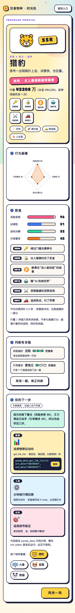
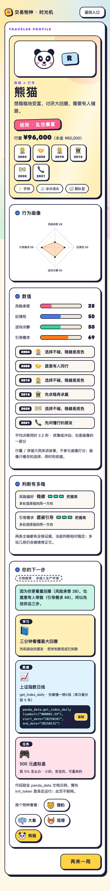

# 交易物种 · 项目说明

PandaAI 苏客松参赛作品。本文与 `README.md` 配套：README 面向评委的快速上手与合规标注，本文展开设计细节——目标用户、画像计分逻辑、推荐匹配逻辑、Panda Data 用法与已知局限。

- **在线试玩（H5，手机可直接打开）**：https://doctors-of-chaos.github.io/trading-species-game/
- **仓库**：https://github.com/Doctors-of-Chaos/trading-species-game （作品本体为单文件 `index.html`，无构建步骤，浏览器打开即玩）
- **团队**：待填写；**联系人**：待填写

## 1. 目标用户与使用场景

| 用户 | 表现 | 游戏给他们的东西 |
|---|---|---|
| 零基础 / 想入门量化的人 | 不懂 K 线，不知从何开始 | 一段无门槛的历史路口体验 + 从「最大回撤是什么」起步的学习路径 |
| 有交易想法但不会验证的人 | 凭盘感、追热点、缺方法 | 对应「提出假设—查数据—检验」类任务卡 |
| 已有研究习惯的独立型用户 | 想自己动手探索 | 数据接口 + 小众可验证的研究任务，不塞科普内容 |

使用场景：PandaAI 首次会话 / 新用户引导页。数分钟内完成一次「认识自己 → 拿到下一步」，不需要账号、不采集数据，关闭即走。

## 2. 玩法流程（约 3 分钟）

1. **新手模式（6 关）**：2004 腾讯、2008 北京楼市、2010 比特币、2015 英伟达、2020 疫情暴跌、2021 元宇宙热潮。每关只展示**当时用户能看到的**信息（价格、新闻氛围），选一张图标卡片表达决策，「时间倒带」揭晓后来发生了什么。
2. **进阶模式（5 个行情盲盒）**：隐去指数名称与年份的真实日线，玩家选明日仓位（空仓/半仓/满仓）并选一条决策依据，同样先看当时信息、后揭晓结果。
3. **结算页**：交易物种人物卡（猎豹/大象/狐狸/熊猫）+ 四维画像雷达图与数值 + 「判断有多稳」置信度（证据不足时出现「再答一题」追问）+ 因人而异的推荐三卡与推荐理由。
4. 结算页还提供**「换个物种看看」**：可切换其他物种查看它们的推荐，直观展示"推荐确实因画像而异"（评审现场追问时可现场对比）。

## 3. 画像模型

### 3.1 四个维度

| 维度 | 含义 | 起始分 |
|---|---|---|
| 风险承受 press | 敢下多重仓位、能否扛回撤 | 50 |
| 纪律性 disc | 是否按规则行动、不追热点 | 50 |
| 逆向冷静 rev | 恐慌/狂热中是否保持独立判断 | 50 |
| 引导需求 need | 想要人带路，还是自己探索 | 50 |

每个选择对相关维度加减分，累加后截断到 0–100。**同一行为可能影响多维**（如"恐慌最盛时逆势进场"= 风险承受 +8、逆向冷静 +8、纪律性 +3）。

### 3.2 行为计分表

**新手模式**（`STORY_DELTA`，每关按行为键计分）：

| 行为（玩家视角文案） | press | disc | rev | need |
|---|---|---|---|---|
| 绕过门槛也要参与（腾讯开户买入） | +8 | +3 | | −5 |
| 众人唱衰时交了定金（2008 楼市） | +8 | +3 | | |
| 敢满仓"没人能没收"的故事（全仓比特币） | +8 | | | |
| 赌"AI 吃掉世界"（英伟达） | +8 | | | |
| 恐慌最盛时逆势进场（2020） | +8 | +3 | +8 | |
| 追进热点，付了学费（2021 上车） | +6 | −8 | −6 | |
| 把"人人都讲"当危险信号（不上车） | | +8 | +5 | −3 |
| 选择不碰，稳健是底色 | −8 | | | |
| 再等等 / 想等更深的低点 | −4 | +3 | | |
| 愿意有人同行（拉人合资） | | | | +8 |
| 先问懂行的朋友 | | | | +8 |
| 五五开 / 先求稳再求赢 / 先求保值（半仓类） | +2 | | | +3 |

**进阶模式**（`DELTA_POS` 仓位 + `META_DELTA` 决策依据）：

| 明日仓位 | press | disc | rev |
|---|---|---|---|
| 空仓 | −7 | +4 | +1 |
| 轻仓（20%） | −3 | +3 | |
| 半仓（50%） | +2 | | |
| 满仓（80%+） | +8 | −4 | −1 |

| 决策依据 | 计分 |
|---|---|
| 看别人都在买 / 听消息（跟风） | need +16 |
| 自己看图判断 | need −2 |
| 用规则/数据说话 | need −5、rev +2 |
| 赌一把 | need −4、press +3 |

**追问修正**（`FOLLOW`，仅在置信度低时出现）：

| 问题 | 选项 → 计分 |
|---|---|
| 账户一天 −8%，你的第一反应？ | 加仓 → press+9、rev+4；不动 → press+2、disc+4；减仓 → press−9、disc+1 |
| 遇到没见过的指标，你会？ | 找人问 → need+10；自己查 → need−7；跑回测 → need−9、rev+2 |

### 3.3 物种与稀有度（画像的表达层）

- 物种按两条轴 2×2 判定：`press ≥ 52` 为**进取**否则**稳健**；`need ≥ 50` 为**引导**否则**独立** → 猎豹（进取×独立）/ 大象（进取×引导）/ 狐狸（稳健×独立）/ 熊猫（稳健×引导）。任一轴距分界 ≤ 7 分时标注「临界」，提示结果可能翻转。
- 稀有度（游戏趣味层，不参与推荐）：`press > 70` 或 `disc < 35` → SSR；`press > 58` 或 `disc < 42` → SR；其余 R。
- **行囊净值与结局只用于讲故事，不参与任何画像计分**——赛题要求"模拟交易收益不能成为衡量用户能力的唯一标准"，这是刻意设计。

### 3.4 置信度：哪些地方还不确定

`levelFor(margin, touches)`：某条轴**反映它的选择少于 2 个**，或**距分界线 < 7 分** → 判为把握低，结算页出现「再答一题」追问题，作答后按 3.2 的追问分表修正画像并重判物种；距分界线 < 15 分或选择少于 3 个 → 中；其余 → 高。每条轴的置信度和理由（如"只有 1 个选择反映了这一维"）直接展示给玩家，做到判断可解释、可修正。

## 4. 推荐逻辑

每种物种固定 3 张卡（`REC`），覆盖「数据 / 工具 / 任务（或学习）」三类；**推荐理由由 `reasonFor` 用玩家实际分数动态生成**，不是静态文案：`"因为你" + (敢下重仓|更看重回撤) + "（风险承受 X），" + (也愿意有人带路|又习惯自己动手) + "（引导需求 Y），所以先给你这三步。"`

| 物种 | 数据卡 | 工具卡 | 任务/学习卡 |
|---|---|---|---|
| 猎豹（进取×独立） | 龙虎榜席位动向 `get_lhb_list` | 分钟级行情回测（规则化持仓） | 追涨信号验证 |
| 大象（进取×引导） | 指数估值温度计 `get_index_indicator` | 定投再平衡模板 | 大象月度路况表 |
| 狐狸（稳健×独立） | 基差与期限结构 `get_future_basis` | QuantSkills 因子库（小样本实验） | 首日大涨会延续吗 |
| 熊猫（稳健×引导） | 上证指数日线 `get_index_daily` | ——（学习卡：三分钟看懂最大回撤） | 500 元虚拟盘 |

- 每张卡都是**可体验的下一步**：数据卡附 `panda_data` 示例代码（页面注明"代码来自 panda_data 文档示例，需先 init_token 登录后运行；游戏不联网"）；任务卡给出具体可操作的小实验；学习卡对应入门内容。
- **示例资源标注**：工具卡/任务卡目前为示例（未接入生产环境），页面与 README 已注明；4 个数据接口的示例代码取自官方文档并已实际调用跑通。
- 推荐差异可直接验证：同一结算页点「换个物种看看」即可看到其他物种的推荐组合；两条演示路径的推荐完全不同（见 §6）。

## 5. Panda Data 使用方式

| 环节 | 用法 | 状态 |
|---|---|---|
| 游戏情境构建 | 进阶模式 15 个行情盲盒使用真实指数/个股日线（最初经 AKShare 获取） | 其中 **13 个窗口共 1105 根 K 线已用 Panda Data 逐日核对收盘价一致**；2004 上证50、2008 中证500 两窗口待核（核对脚本 `tools/verify_panda.py` 已备好） |
| 揭晓页事实 | 2020 沪深300：3688.36 → 5211.29（+41.3%）；2015–2024 英伟达约 278 倍 | 已用 Panda Data 核对 |
| 揭晓页事实 | 2004 腾讯：发行价 3.7 港元 → 2021 年 1 月高点，拆股+分红复权约 **1046 倍**（结算按「单关 ×1000 封顶」规则记账） | 已按复权行情核对；Panda Data 交叉验证随上项脚本执行 |
| 故事化数字 | 2008 北京房价、白马股、黄金、元宇宙回撤 | 叙事设定，统一标注于首页页脚说明 |
| 推荐卡示例代码 | `get_lhb_list` / `get_index_indicator` / `get_future_basis` / `get_index_daily` | 均已实际调用跑通 |
| 运行时 | 页面**零网络请求**，不内置任何密钥；核对与调用在开发期完成 | 符合隐私要求 |

时间口径：盲盒窗口的 K 线为 `[YYYYMMDD, open, high, low, close]` 日线；每关先只展示决策日之前的信息，结果在「倒带」揭晓后才出现——满足"区分玩家当时可见信息与后续结果"的要求。

## 6. 差异化演示：两条行为路径

现场演示建议顺序：先完整走路径 A，再走路径 B，对比结算页；评委可任意改变一关的选择，画像按 §3.2 计分表实时变化。

| | 路径 A：激进 | 路径 B：稳健 |
|---|---|---|
| 六关选择 | 开户买入、交定金、全仓买入、赌 AI、逆势进场、上车！ | 不碰新股、拉人合资、关掉网页、买白马股、现金为王、问问朋友 |
| 四维（press/disc/rev/need） | **96 / 51 / 52 / 45** | **28 / 50 / 50 / 69** |
| 物种 | 猎豹 · SSR · 进取×独立 · 临界 | 熊猫 · R · 稳健×引导 |
| 判断有多稳 | 风险偏好：把握高；引导需求：把握低（仅 1 个选择反映）→ **出现追问** | 两条轴均把握高 → 不追问 |
| 推荐三卡 | 龙虎榜席位动向、分钟级行情回测、追涨信号验证 | 三分钟看懂最大回撤、上证指数日线、500 元虚拟盘 |
| 行囊 / 结局 | ¥2285 万 / 史上最强裂缝穿越者 | ¥96,000 / 乱世暴富 |
| 结算页截图 |  |  |

**结构化画像与推荐结果示例**（JSON，仅含画像与推荐、不含逐条原始选择，供 PandaAI 接入构想参考）：

```json
{
  "dims": { "press": 96, "disc": 51, "rev": 52, "need": 45 },
  "species": { "key": "leopard", "name": "猎豹", "axes": "进取 × 独立", "rarity": "SSR", "borderline": true },
  "confidence": [
    { "axis": "press", "label": "风险偏好", "value": "进取", "level": "高", "basis": "多处选择指向同一方向" },
    { "axis": "need",  "label": "引导需求", "value": "爱独立", "level": "低", "basis": "只有 1 个选择反映了这一维", "follow_up_available": true }
  ],
  "recommendation": {
    "reason": "因为你敢下重仓（风险承受 96），又习惯自己动手（引导需求 45），所以先给你这三步。",
    "cards": [
      { "category": "数据", "title": "龙虎榜席位动向", "api": "get_lhb_list", "note": "谁在拉、谁在跑，比新闻快一步", "example_code": "panda_data.get_lhb_list(start_date=\"20250101\", end_date=\"20250131\")" },
      { "category": "工具", "title": "分钟级行情回测", "api": null, "note": "把盘感写成 if-else，让回测打分", "example_code": null },
      { "category": "任务", "title": "追涨信号验证", "api": null, "note": "追，到底赚不赚钱？", "example_code": null }
    ]
  }
}
```

路径 B 的对应 JSON：`dims = {press:28, disc:50, rev:50, need:69}`、物种熊猫（R，非临界）、两条置信度均为"高"、推荐卡为"三分钟看懂最大回撤 / 上证指数日线（get_index_daily）/ 500 元虚拟盘"。

## 7. 已知局限

- 仅在 Chrome（桌面 1280 与手机 390px）完整测试；Safari、Firefox、微信内置浏览器与真机 iOS 已初步验证（iOS 描边渲染问题已修复），但未覆盖全部机型。
- 新手模式的故事化数字（2008 北京房价、白马股、黄金、元宇宙回撤）为叙事设定，首页页脚统一标注；腾讯倍数已按复权行情核对（约 1046 倍，结算按规则 ×1000 封顶）；进阶盲盒 15 个窗口中 2 个尚未与 Panda Data 对照（核对脚本已备好）。
- 「倒带曲线」为示意动画，非逐日行情。
- 推荐中的工具卡与任务卡为示例资源（已标注），未接入 PandaAI 生产环境；演示用结构化结果见 §6。
- 无模拟用户、不使用真实用户数据；尚未收集真实试玩反馈样本。

---

*文档由比赛期间助手整理（2026-11-01），基于 `index.html` 内置计分数据与实测两条路径的结算结果。*
